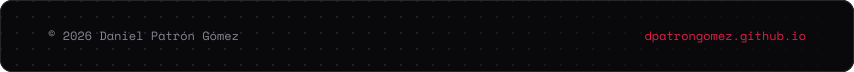

  

   

  
  
  
  

   

  

 

### Sobre mí

Desarrollador Front-End y de aplicaciones multiplataforma. Me centro en interfaces rápidas, accesibles y con precisión visual.

Actualmente en **BBVA Technology en Europa**, donde construyo interfaces para la aplicación móvil de banca internacional con **Lit, Web Components y Ember.js**. Fuera del trabajo publico apps con **Flutter y Android**; todo lo que hago está en mi [portfolio](https://dpatrongomez.github.io/).

---

### Proyectos destacados

| Proyecto | Descripción | Stack |
| :-- | :-- | :-- |
| [**Pluggy**](https://github.com/dpatrongomez/pluggy) | Localiza y consulta puntos de recarga de vehículos eléctricos en tiempo real. | Flutter · Dart · Android |
| [**Urbanos Guadalajara**](https://github.com/dpatrongomez/urbanosguadalajara) | Itinerarios y horarios de los autobuses urbanos de Guadalajara. | Flutter · Dart · Android |
| [**MercaList**](https://github.com/dpatrongomez/mercalist) | Listas de la compra conectadas con el catálogo oficial de Mercadona. | Flutter · REST API |
| [**Precio Luz**](https://github.com/dpatrongomez/precioluz) | Precio de la electricidad por horas en España. | Flutter · REST API |

Todas están publicadas en Google Play. El resto, en [mi portfolio](https://dpatrongomez.github.io/#portfolio).

---

### Stack

  
  
  
  
  
  
  
  
  
  
  
  

---

  

    

  

